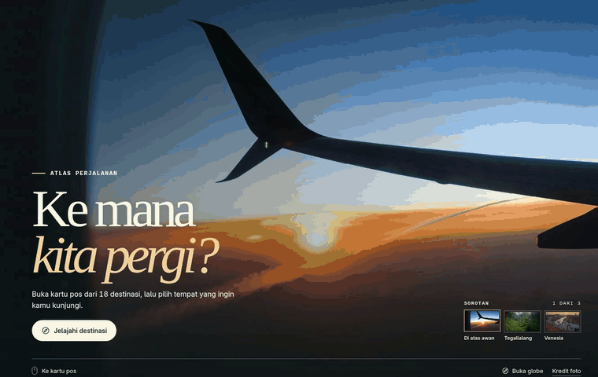

# Sela

Atlas perjalanan berbahasa Indonesia dengan 18 destinasi di enam benua. Balik tumpukan kartu pos, pilih sebuah kota, lalu susun agenda untuk satu sampai tiga hari.



## Menjelajahi atlas

- **Kartu pos.** Geser tumpukan, ketuk kartu teratas, atau gunakan tombol panah untuk melihat destinasi berikutnya. Pilih **Lihat destinasi** untuk membuka foto, kegiatan, dan ide perjalanan harian.
- **Globe.** Seret bola dunia atau fokuskan globe dan gunakan tombol panah. Pilih titik destinasi, atau buka **Ukur jarak antardestinasi** untuk menggambar rute dan melihat jarak terpendek di permukaan bumi.
- **Indeks destinasi.** Cari berdasarkan nama kota atau negara. Persempit hasil dengan memilih benua dan kategori alam, kota, atau pesisir.
- **Rencana perjalanan.** Tandai kartu dengan tombol **Simpan**. Dari halaman destinasi, pilih **Susun rencana** untuk mengatur tanggal dan durasi.
- **Gerakan.** Sorotan berganti saat halaman digulir. Tombol bereaksi saat ditekan dan penanda bergerak singkat saat kartu disimpan. Intensitas gerak mengikuti pengaturan perangkat. Efek juga bisa dimatikan lewat menu.

## Tampilan aplikasi

### Kartu pos Positano


### Mengukur jarak pada globe


### Halaman Venesia


## Bahasa pemrograman dan teknologi


| Bahasa / teknologi | Penggunaan dalam proyek |
| --- | --- |
| **HTML5** | Struktur halaman, navigasi, formulir, dialog, dan elemen aplikasi. |
| **CSS3** | Tata letak responsif, tipografi, tampilan kartu, serta animasi dan transisi. |
| **JavaScript (ES Modules)** | Interaksi aplikasi, pencarian destinasi, penyimpanan rencana, navigasi, globe, dan animasi. |
| **Python 3** | Menjalankan server lokal melalui `jalankan_sela.py`. Python hanya diperlukan untuk cara menjalankan aplikasi secara lokal, bukan untuk GitHub Pages. |
| **GLSL** | Kode *shader* untuk efek relief topografi yang dijalankan melalui WebGL 2. Kode shader ditulis di dalam `relief-webgl.js`. |
| **WebGL 2 dan Canvas 2D** | Teknologi grafis untuk menampilkan relief topografi dan menyediakan tampilan alternatif pada perangkat yang tidak mendukung WebGL 2. |

## Struktur folder

Pertahankan susunan berikut ketika mengunggah proyek. Jangan memindahkan file gambar keluar dari folder `assets` atau `media`.

```text
Sela-Atlas/
├── index.html
├── README.md
├── .nojekyll
├── style.css
├── motion.css
├── atlas.css
├── app.js
├── data.js
├── world-data.js
├── motion.js
├── atlas.js
├── globe.js
├── relief.js
├── relief-webgl.js
├── jalankan_sela.py
├── JALANKAN_SELA.bat
├── assets/
│   ├── mark.svg
│   ├── land-dots.json
│   ├── inter.woff2
│   └── ... foto dan aset aplikasi lainnya
└── media/
    ├── sorotan.gif
    ├── kartu-pos.jpg
    ├── globe.jpg
    └── venesia.jpg
```

## Menjalankan di komputer

Di Windows dengan Python 3.8 atau lebih baru, ekstrak seluruh ZIP lalu klik dua kali `JALANKAN_SELA.bat`. Browser akan membuka atlas dan terminal menampilkan alamatnya. Biarkan terminal terbuka selama memakai Sela. Jika port 8000 sedang digunakan, aplikasi memilih port kosong secara otomatis.

Untuk menjalankannya secara manual, ekstrak arsip dan buka terminal di folder yang berisi `index.html`. Jika Python 3 tersedia, jalankan server statis berikut.

```sh
python3 -m http.server 8000
```

Buka [localhost di port 8000](http://localhost:8000). Foto, font, dan peta sudah tersedia di folder `assets`.

## Mengunggah ke GitHub

Agar gambar dan GIF tampil di README serta aplikasi dapat berjalan melalui GitHub Pages:

1. Ekstrak ZIP terlebih dahulu di komputer. **Jangan mengunggah file ZIP sebagai satu-satunya isi repositori.**
2. Buka repositori GitHub, lalu unggah seluruh isi folder hasil ekstraksi. Pastikan `README.md`, `index.html`, folder `assets`, dan folder `media` berada di tingkat teratas repositori seperti pada struktur folder di atas.
3. Pastikan file `media/sorotan.gif`, `media/kartu-pos.jpg`, `media/globe.jpg`, dan `media/venesia.jpg` ikut terunggah. Nama file dan huruf besar-kecilnya harus sama persis.
4. Buka **Settings → Pages**.
5. Di bagian **Build and deployment**, pilih **Deploy from a branch**. Pilih cabang yang berisi aplikasi, misalnya `main`, lalu pilih folder `/(root)`. Klik **Save**.
6. Setelah proses penerbitan selesai, buka alamat situs yang ditampilkan pada halaman **Pages**.

Semua tautan aset lokal di proyek menggunakan path relatif. Dengan demikian, aset tetap mengarah ke folder proyek saat repositori diterbitkan pada alamat GitHub Pages, termasuk ketika situs berada di subpath nama repositori.

Jika gambar README belum muncul setelah unggah, periksa apakah folder `media` benar-benar sudah masuk ke repositori dan apakah README berada pada tingkat folder yang sama dengan `media`.

[Panduan penerbitan GitHub Pages](https://docs.github.com/en/pages/getting-started-with-github-pages/configuring-a-publishing-source-for-your-github-pages-site)

## Kredit

Nama fotografer dan tautan ke sumber Unsplash tersedia lewat **Kredit foto** di aplikasi. Bentuk daratan pada globe menggunakan [Natural Earth](https://www.naturalearthdata.com/). Ketentuan untuk font Inter dan efek relief tersedia di [lisensi Inter](./assets/Inter-OFL.txt) dan [lisensi React Bits](./assets/React-Bits-LICENSE.md).
