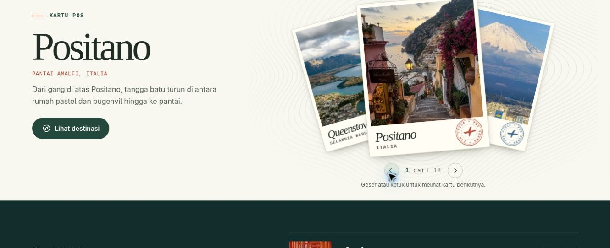
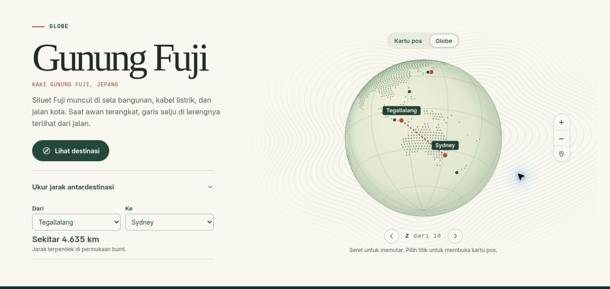
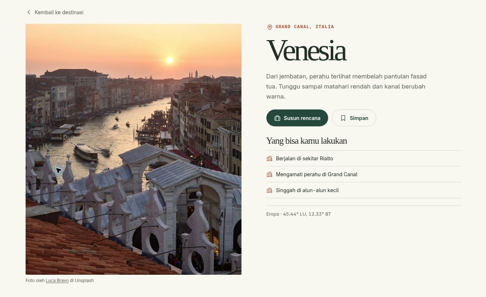

# Sela

Atlas perjalanan berbahasa Indonesia dengan 18 destinasi di enam benua. Balik tumpukan kartu pos, pilih sebuah kota, lalu susun agenda untuk satu sampai tiga hari.


## Menjelajahi atlas

- **Kartu pos.** Geser tumpukan, ketuk kartu teratas, atau gunakan tombol panah untuk melihat destinasi berikutnya. Pilih **Lihat destinasi** untuk membuka foto, kegiatan, dan ide perjalanan harian.
- **Globe.** Seret bola dunia atau fokuskan globe dan gunakan tombol panah. Pilih titik destinasi, atau buka **Ukur jarak antardestinasi** untuk menggambar rute dan melihat jarak terpendek di permukaan bumi.
- **Indeks destinasi.** Cari berdasarkan nama kota atau negara. Persempit hasil dengan memilih benua dan kategori alam, kota, atau pesisir.
- **Rencana perjalanan.** Tandai kartu dengan tombol **Simpan**. Dari halaman destinasi, pilih **Susun rencana** untuk mengatur tanggal dan durasi.
- **Gerakan.** Sorotan berganti saat halaman digulir. Tombol bereaksi saat ditekan dan penanda bergerak singkat saat kartu disimpan. Intensitas gerak mengikuti pengaturan perangkat. Efek juga bisa dimatikan lewat menu.

## Tampilan aplikasi

### Kartu pos Positano



### Mengukur jarak pada globe



### Halaman Venesia



## Bahasa dan teknologi

| Bahasa | Pemakaian |
| --- | --- |
| HTML | Halaman, navigasi, formulir, dan dialog |
| CSS | Tata letak responsif, tampilan kartu, dan animasi tombol |
| JavaScript | Pencarian, rencana perjalanan, pengendali globe, dan animasi melalui Web Animations API |
| GLSL | Shader WebGL 2 untuk relief topografi. Canvas 2D menggambar relief pada perangkat yang memerlukan alternatif. |

## Menjalankan di komputer

Di Windows dengan Python 3.8 atau lebih baru, ekstrak seluruh ZIP lalu klik dua kali `JALANKAN_SELA.bat`. Browser akan membuka atlas dan terminal menampilkan alamatnya. Biarkan terminal terbuka selama memakai Sela. Jika port 8000 sedang digunakan, aplikasi memilih port kosong secara otomatis.

Untuk menjalankannya secara manual, ekstrak arsip dan buka terminal di folder yang berisi `index.html`. Jika Python 3 tersedia, jalankan server statis berikut.

```sh
python3 -m http.server 8000
```

Buka [localhost di port 8000](http://localhost:8000). Foto, font, dan peta sudah tersedia di folder `assets`.

## Mengunggah ke GitHub Pages

1. Ekstrak ZIP, lalu unggah seluruh isinya ke repositori. Letakkan `index.html`, `README.md`, folder `assets`, dan folder `media` di tingkat teratas.
2. Di repositori, buka **Settings → Pages**.
3. Di **Build and deployment**, pilih **Deploy from a branch**. Pilih cabang yang berisi berkas aplikasi, misalnya `main`, lalu folder `/(root)`. Klik **Save**.
4. Setelah penerbitan selesai, buka alamat situs yang ditampilkan di halaman **Pages**.

[Panduan penerbitan GitHub Pages](https://docs.github.com/en/pages/getting-started-with-github-pages/configuring-a-publishing-source-for-your-github-pages-site)

## Kredit

Nama fotografer dan tautan ke sumber Unsplash tersedia lewat **Kredit foto** di aplikasi. Bentuk daratan pada globe menggunakan [Natural Earth](https://www.naturalearthdata.com/). Ketentuan untuk font Inter dan efek relief tersedia di [lisensi Inter](assets/Inter-OFL.txt) dan [lisensi React Bits](assets/React-Bits-LICENSE.md).
